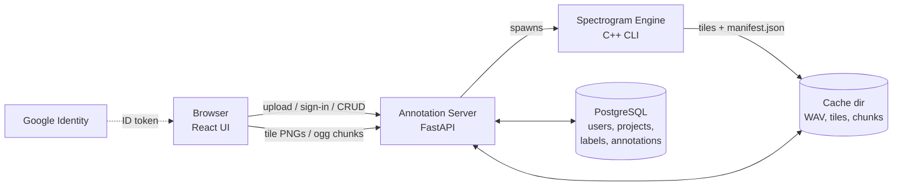
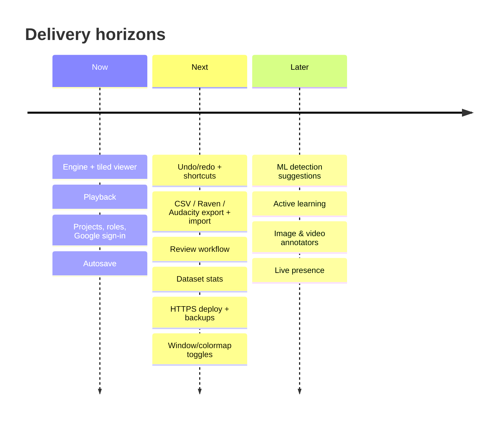

# Spectrogram Annotator — Product Backlog

> [!abstract] What this is
> A web tool for labelling long field recordings (birdsong, bioacoustics) on a zoomable spectrogram, with shared projects, roles and autosave. It has three parts:
> - **Spectrogram Engine** (C++), which turns audio into a pyramid of PNG tiles plus a `manifest.json`.
> - **Annotation Server** (FastAPI + PostgreSQL), which handles upload, transcoding, playback chunks, auth, projects and annotations.
> - **Annotator UI** (React + Vite), which covers login, projects, the tile viewer, playback and annotation editing.
>
> This note lists the **epics → user stories → acceptance criteria** for what is built today, plus a forward-looking vision.

> [!info] How to read this note
> - **Status tags:** #status/done = shipped · #status/partial = some of it is built · #status/planned = next up · #status/vision = longer-term idea
> - Acceptance criteria use checkboxes. `- [x]` means met in the current code, `- [ ]` means not met yet.
> - Link to any story from other notes by its heading, e.g. `[[Spectrogram Annotator - Product Backlog#US-5.2 Shared label vocabulary]]`.
> - Personas are defined once below and linked from the stories.

---

## Contents

- [[#Personas]]
- [[#System overview]]
- [[#Roadmap at a glance]]
- **Built today**
  - [[#Epic 1 — Spectrogram Engine]]
  - [[#Epic 2 — Spectrogram Viewer & Navigation]]
  - [[#Epic 3 — Audio Playback]]
  - [[#Epic 4 — Media Upload & Ingestion]]
  - [[#Epic 5 — Annotation Authoring]]
  - [[#Epic 6 — Export & Interoperability]]
  - [[#Epic 7 — Accounts & Sign-in]]
  - [[#Epic 8 — Projects, Teams & Roles]]
  - [[#Epic 9 — Persistence & Autosave]]
  - [[#Epic 10 — Deployment & Operations]]
- **Vision**
  - [[#Epic 11 — Image & Video Annotation]]
  - [[#Epic 12 — Review & Quality Assurance]]
  - [[#Epic 13 — Machine-Assisted Annotation]]
  - [[#Epic 14 — Dataset Search, Analytics & Export]]
  - [[#Epic 15 — Real-time Collaboration]]
  - [[#Epic 16 — Annotator Productivity & Accessibility]]
  - [[#Epic 17 — Viewer Rendering Controls]]
- [[#Non-functional requirements]]
- [[#Glossary]]

---

## Personas

| Persona | Who they are | What they care about |
|---|---|---|
| **Annotator** | Student or researcher labelling calls in recordings | Fast navigation, precise boxes, never losing work |
| **Project Admin** | Lab lead or TA running a labelling effort | Inviting people, a consistent label vocabulary, cleaning up mistakes |
| **Project Owner** | PI who owns the dataset | Control over who is admin, the ability to delete the project, dataset integrity |
| **Viewer** | Collaborator or reviewer | Reading annotations without being able to change them |
| **Data Scientist** | Uses the labels downstream (e.g. the NDSU pipeline, SpectrogramPlayer) | Clean, stable export formats |
| **Lab Sysadmin** | Runs the Linux server | Simple self-hosted setup, backups, no paid services |

---

## System overview

**Data model (PostgreSQL):** `users` → `project_members` (role) → `projects` → `media_files` → `annotations` ← `labels`, plus `project_invites` for people who haven't signed in yet.

---

## Roadmap at a glance

| # | Epic | Status | Horizon |
|---|---|---|---|
| 1 | Spectrogram Engine | #status/done | Now |
| 2 | Viewer & Navigation | #status/done | Now |
| 3 | Audio Playback | #status/done | Now |
| 4 | Media Upload & Ingestion | #status/done | Now |
| 5 | Annotation Authoring | #status/partial | Now → Next |
| 6 | Export & Interoperability | #status/partial | Next |
| 7 | Accounts & Sign-in | #status/done | Now |
| 8 | Projects, Teams & Roles | #status/done | Now |
| 9 | Persistence & Autosave | #status/done | Now |
| 10 | Deployment & Operations | #status/partial | Next |
| 11 | Image & Video Annotation | #status/vision | Later |
| 12 | Review & QA | #status/planned | Next |
| 13 | Machine-Assisted Annotation | #status/vision | Later |
| 14 | Dataset Search, Analytics & Export | #status/planned | Next |
| 15 | Real-time Collaboration | #status/vision | Later |
| 16 | Productivity & Accessibility | #status/planned | Next |
| 17 | Viewer Rendering Controls | #status/planned | Next |

---

# Built today

## Epic 1 — Spectrogram Engine
#epic #status/done #area/engine

> [!summary] Goal
> Precompute a spectrogram once into map-style tiles, so that even a multi-hour recording opens and zooms instantly without being recomputed in the browser.

### US-1.1 Generate a tile pyramid from an audio file
**As a** [[#Personas|Lab Sysadmin]], **I want** the server to turn any uploaded WAV/MP3/FLAC into spectrogram tiles **so that** annotators can view it at every zoom level.

- [x] Decodes WAV, MP3 and FLAC, and mixes multi-channel audio down to mono.
- [x] Builds one pyramid per requested FFT window (default `1024,4096`). Each level halves the time axis by max-pooling.
- [x] Writes fixed-width PNG tiles (default 512 columns) to `w{window}/L{level}/{tile}.png`.
- [x] Writes a `manifest.json` (v2) holding everything a UI needs to map pixels ↔ time/frequency.
- [x] Rejects window sizes above 8192 and a `--hop` given together with multiple windows.

### US-1.2 Bounded memory on long recordings
**As a** Lab Sysadmin, **I want** memory use to stay bounded regardless of how long the recording is **so that** a 2-hour file can't take down the server.

- [x] Streams decode → STFT → tiles in blocks by default.
- [x] Peak memory is set by the largest window × chunk size, not by duration (~620 MB at the defaults for both 75 min and 2 h).
- [x] `--no-stream` produces **byte-identical** output as a reference path.

### US-1.3 Fast, deterministic parallel processing
- [x] Uses all CPU cores by default (`--threads 0`).
- [x] Multi-threaded output is byte-for-byte identical to single-threaded.
- [x] Writes `metrics.txt` with stage timings and sizes.

### US-1.4 Verifiable correctness
**As a** developer, **I want** synthetic test signals with known answers **so that** I can prove the tiles are correct.

- [x] `make_test_audio.py` generates sine, chirp and silence.
- [x] `verify_tiles.py --expect-sweep` checks the chirp diagonal at every level, with no seams at tile boundaries.

### US-1.5 Background generation with status
- [x] The server runs the engine in the background after upload and exposes `GET /tiles-status/{file_id}`.
- [x] Re-uses existing tiles if the cache survived a restart.
- [ ] Shows a generation progress percentage, not just a state. #status/planned

---

## Epic 2 — Spectrogram Viewer & Navigation
#epic #status/done #area/viewer

> [!summary] Goal
> Explore hours of audio as smoothly as a map, and always know exactly what time and frequency you're looking at.

### US-2.1 Pan and zoom in time
**As an** [[#Personas|Annotator]], **I want** to drag to pan and scroll to zoom **so that** I can move between a whole-file overview and millisecond detail.

- [x] Drag pans and mouse wheel zooms around the cursor.
- [x] The viewer picks the pyramid level that best matches the current seconds-per-pixel.
- [x] A click without dragging seeks playback to that time.

### US-2.2 Zoom and pan in frequency
- [x] Shift + wheel zooms frequency.
- [x] The frequency ruler sidebar supports drag-to-pan, scroll-to-zoom and grips at the ends to resize the band.
- [x] Opens fitted to the band the engine detected.

### US-2.3 Rulers that stay readable
- [x] The time ruler picks "nice" major/minor ticks down to 1 ms and adds decimal digits as you zoom.
- [x] Frequency ruler labels never collide and print in Hz/kHz.
- [x] The visible band's end values are always shown.

### US-2.4 Responsive tile loading
**As an** Annotator on a slow lab network, **I want** the tiles I'm looking at to load first **so that** the screen fills in quickly.

- [x] Visible tiles are prioritised over prefetch, and requests that went off-screen are aborted.
- [x] Failed tiles retry with backoff up to a max attempt count, then log a warning.
- [x] Uses an LRU of decoded `ImageBitmap`s with eviction.
- [x] Falls back to a coarser level while finer tiles load.

### US-2.5 Overview navigation
- [x] The waveform overview shows the whole file with a viewport rectangle that follows the spectrogram's pan/zoom.
- [x] The overview shows tile-loading progress (loaded vs in-flight sections).
- [x] A debug toggle switches to chunk-list navigation.

### US-2.6 Switch FFT window #status/partial
**As an** Annotator, **I want** to switch between short and long FFT windows **so that** I can trade time resolution against frequency resolution.

- [x] The engine precomputes multiple windows, and the viewer reads `windows[]` and opens on `defaultWindow`.
- [ ] Window toggle buttons in the annotator header, keeping the current time range.
- [ ] Shows the active window's ms length and Hz/bin.

---

## Epic 3 — Audio Playback
#epic #status/done #area/playback

### US-3.1 Play exactly what I see
**As an** Annotator, **I want** to play audio from any point **so that** I can confirm a call by ear.

- [x] Space plays/pauses (except when a button has focus).
- [x] ← / → skip 5 s, with matching buttons in the playback bar.
- [x] The playhead is drawn on the spectrogram and the playback bar.
- [x] Clicking the spectrogram or the overview seeks.

### US-3.2 Stream on demand, compressed
- [x] The server transcodes per-chunk audio to Ogg (MP3 fallback) when it's first requested, then caches it.
- [x] Chunks line up sample-accurately with annotation timestamps.
- [x] Playback crosses chunk boundaries seamlessly.

### US-3.3 Playback controls
- [x] Mute/unmute.
- [x] Playback speed selector.
- [x] Shows current position and duration, with hours when the file needs them.
- [ ] Loop the selected annotation or region. #status/planned
- [ ] Play only the frequency band inside a box (band-pass audition). #status/vision

---

## Epic 4 — Media Upload & Ingestion
#epic #status/done #area/ingest

### US-4.1 Upload with clear progress
**As an** Annotator, **I want** to see the hashing, uploading and decoding stages with progress **so that** I know a large file is actually moving.

- [x] Drag-and-drop zone or file picker (`.wav .mp3 .ogg .flac .aac .m4a`).
- [x] Phases are shown separately: hashing → uploading (bytes/percent) → decoding.
- [x] The project page supports multi-file upload.

### US-4.2 Never re-upload a file the server already has
- [x] SHA-1 is hashed in a Web Worker on the client.
- [x] If the server already has that `file_id`, the upload is skipped and the file just registers in the project.
- [x] A file is unique per project by `content_hash`.

### US-4.3 Standalone mode
**As a** casual user, **I want** to annotate a file at `/audio` without a project **so that** I can try the tool quickly.

- [x] Works without the database. Annotations stay in memory, and Export JSON is how you keep them.
- [ ] Warns before leaving the page with unsaved local annotations. #status/planned

---

## Epic 5 — Annotation Authoring
#epic #status/partial #area/annotation

> [!summary] Goal
> Draw precise time–frequency boxes, give each one a shared label, and fix mistakes easily.

### US-5.1 Draw a time–frequency box
**As an** Annotator, **I want** to drag a box over a call on the spectrogram **so that** I capture both when it happens and its frequency band.

- [x] **A** toggles annotate mode (only for roles that can annotate). Outside annotate mode, the mouse navigates.
- [x] Dragging creates a box with `start_sec`, `end_sec`, `freq_min_hz`, `freq_max_hz`.
- [x] The label picker opens on release: choose an existing label or type a new one. Enter confirms and Esc cancels.
- [x] Boxes stay correctly placed while panning/zooming.

### US-5.2 Shared label vocabulary
**As a** [[#Personas|Project Admin]], **I want** one label list per project **so that** everyone uses the same names.

- [x] Label names are unique per project, case-insensitively, and typed names resolve to existing labels.
- [x] Each label has a colour and a display height, and labels show as tabs/layers in the panel.
- [x] A label can be shown or hidden on the spectrogram.
- [x] A label that annotations still use can't be deleted (HTTP 409).

### US-5.3 Edit and review annotations in a list
- [x] Annotations are grouped by label in the side panel.
- [x] Inline editing of name, start and end, with ✓/✕.
- [x] Double-clicking a row jumps to that time.
- [x] The tooltip shows who created the annotation.
- [ ] Notes field editable in the UI (`annotations.notes` already exists in the schema). #status/planned
- [ ] Drag box edges on the spectrogram to resize. #status/planned
- [ ] Move an annotation to a different label. #status/planned

### US-5.4 Role-aware editing
- [x] Annotators can edit/delete only their own annotations and labels.
- [x] Admins and owners can edit/delete anyone's.
- [x] Viewers see a **View only** badge and no editing controls.
- [x] Every one of these rules is also enforced on the server.

### US-5.5 Undo / redo #status/planned
- [ ] Ctrl+Z / Ctrl+Shift+Z undo and redo create, edit and delete.
- [ ] An undo that touches the server also syncs (a re-created annotation keeps its label and creator).

---

## Epic 6 — Export & Interoperability
#epic #status/partial #area/export

### US-6.1 Export a full project JSON
**As a** [[#Personas|Data Scientist]], **I want** a JSON export of every label and annotation **so that** I can feed it into my pipeline.

- [x] Includes `version`, `audioFile`, `exportedAt`, and layers with id, title, colour and height.
- [x] Each annotation carries a denormalised `label` for downstream consumers.
- [x] Copy to clipboard or download.

### US-6.2 SpectrogramPlayer format
- [x] A second tab exports `[start, end, label]` tuples per layer, sorted by start.

### US-6.3 Include frequency bounds and authorship in exports #status/planned
- [ ] Exports include `freq_min_hz` / `freq_max_hz`, `created_by`, `notes`, and timestamps.
- [ ] The export schema is versioned, and adding a field never breaks older readers.

### US-6.4 Standard bioacoustics formats #status/planned
- [ ] CSV export.
- [ ] Raven Pro selection table (`.txt`) export.
- [ ] Audacity label track export.
- [ ] Import from Raven, Audacity and our own JSON, with a preview and conflict summary before committing.

### US-6.5 Project-wide export #status/planned
- [ ] Export every file's annotations in a project as one archive.
- [ ] Filter the export by label, annotator, or date range.

---

## Epic 7 — Accounts & Sign-in
#epic #status/done #area/auth

### US-7.1 Sign in with Google
**As an** Annotator, **I want** to sign in with my Google (UNCW) account **so that** I don't need another password.

- [x] The frontend reads `GET /auth/config` first to learn whether sign-in is on and get the Google client ID.
- [x] `POST /auth/google` verifies the ID token, then creates or updates the user, keyed on Google `sub` and linked by email.
- [x] Returns a signed session token, which every later request sends as `Bearer`.
- [x] Pending project invites for that email are accepted automatically.

### US-7.2 Developer login for local testing
- [x] With `DEV_LOGIN=true`, anyone can sign in by typing an email, so several users and roles can be tested without Google.
- [x] The server prints a large warning while this is on.
- [x] The docs say never to enable it on the lab server.

### US-7.3 Graceful no-auth mode
- [x] Until `GOOGLE_CLIENT_ID` is set (and dev login is off), project pages explain that they're unavailable instead of breaking, and `/audio` still works.
- [x] `REQUIRE_AUTH=true` makes every API call need a session.

### US-7.4 Session lifecycle #status/planned
- [ ] Sign-out explicitly invalidates the token on the server.
- [ ] An expired session redirects to login and returns you to the page you were on.
- [ ] Restrict sign-in to an allow-listed domain (e.g. `uncw.edu`) via config.

---

## Epic 8 — Projects, Teams & Roles
#epic #status/done #area/projects

### US-8.1 Create and manage projects
- [x] Projects homepage lists my projects with my role badge.
- [x] The creator becomes **owner** automatically (database trigger).
- [x] Admins and above can rename a project; only owners can delete it.

### US-8.2 Invite people by email
**As a** Project Admin, **I want** to add people by email even if they've never signed in **so that** onboarding a class is one step.

- [x] Existing users are added immediately. Anyone else gets a pending invite.
- [x] An invite is accepted on that person's first sign-in.
- [x] Pending invites can be cancelled.

### US-8.3 Role hierarchy enforced on the server

| Role | Can |
|---|---|
| viewer | see everything in the project |
| annotator | + upload files, create labels and annotations, edit/delete their own |
| admin | + edit/delete anyone's labels, files and annotations, rename the project, manage viewers and annotators |
| owner | + manage admins and owners, delete the project |

- [x] `has_project_role()` checks the minimum role on every call.
- [x] You can only grant or manage roles below your own (owners can manage owners).
- [x] A project can never be left without an owner (database trigger).

### US-8.4 Project media library
- [x] Lists media with type, duration and uploader.
- [x] Opens the right annotator for the media type (audio for now, "coming soon" for image/video).
- [x] Admins can delete media, which cascades to its annotations.
- [ ] Per-file progress: annotation count, and a "done" flag set by an annotator. #status/planned

---

## Epic 9 — Persistence & Autosave
#epic #status/done #area/persistence

### US-9.1 Never lose work
**As an** Annotator, **I want** every change saved automatically **so that** closing the tab never costs me anything.

- [x] Project annotations save to the server on each change. Label edits are debounced.
- [x] Pending debounced edits are flushed when leaving the page.
- [x] A save indicator shows saving, saved and error.
- [ ] Changes made offline are queued and replayed when the connection comes back. #status/vision

---

## Epic 10 — Deployment & Operations
#epic #status/partial #area/ops

### US-10.1 Self-hosted, free stack
- [x] Runs on the lab's Linux server with PostgreSQL 13+. No paid services.
- [x] `DATABASE.md` covers install, schema, `.env`, pgAdmin over an SSH tunnel, and Google setup.
- [x] Windows local-dev instructions.

### US-10.2 Configurable cache
- [x] `SPECTROGRAM_CACHE_DIR` holds the decoded WAV, tiles and chunks on local disk.
- [x] `DELETE /file/{file_id}` evicts cached data.
- [ ] Automatic cache eviction policy (LRU by size/age). #status/planned

### US-10.3 Production hardening #status/planned
- [ ] HTTPS behind a reverse proxy, with a hostname (required for Google sign-in).
- [ ] Nightly `pg_dump` backups with rotation, plus a restore drill.
- [ ] Versioned schema migrations instead of a one-shot `schema.sql`.
- [ ] Structured logs, plus a `/health` that checks the DB and engine binary.
- [ ] A one-command deploy (systemd units or docker compose).

---

# Vision

> [!tip] Looking ahead
> The epics below go past what exists today. They build on groundwork already in the schema (`media_type` image/video, `annotations.extra` jsonb, `notes`) and on the lab's research workflow.

## Epic 11 — Image & Video Annotation
#epic #status/vision #area/multimodal

### US-11.1 Image annotator
**As an** Annotator, **I want** to draw boxes and polygons on camera-trap photos **so that** one project can hold every kind of evidence.

- [ ] Box and polygon tools, with geometry stored in `annotations.extra`.
- [ ] Uses the same shared project label vocabulary.
- [ ] Zoom/pan is consistent with the spectrogram viewer.

### US-11.2 Video annotator
- [ ] Frame-accurate scrubbing, with time-range annotations (`start_sec`/`end_sec`).
- [ ] Optional boxes per frame with interpolation between keyframes.
- [ ] Spectrogram of the video's audio track, synced under the video.

---

## Epic 12 — Review & Quality Assurance
#epic #status/planned #area/qa

### US-12.1 Review queue
**As a** Project Admin, **I want** to review annotations and accept, reject or comment on each one **so that** the dataset is trustworthy.

- [ ] Each annotation has a status: `draft → submitted → accepted | rejected`.
- [ ] A reviewer queue can be filtered by label, annotator and file.
- [ ] Threaded comments on an annotation, and the annotator is notified.

### US-12.2 Inter-annotator agreement
- [ ] Assign the same file to several annotators with each other's work hidden ("blind" mode).
- [ ] An agreement report (IoU-matched boxes, per-label precision/recall, Cohen's κ).
- [ ] Disagreements are highlighted side by side on the spectrogram.

### US-12.3 Audit history
- [ ] Every create/edit/delete is recorded with who, when, and the before/after values.
- [ ] Deleted annotations can be restored from history by an admin.

---

## Epic 13 — Machine-Assisted Annotation
#epic #status/vision #area/ml

### US-13.1 Detection suggestions
**As an** Annotator, **I want** a model (e.g. BirdNET or a lab-trained classifier) to propose candidate boxes **so that** I confirm calls instead of hunting for them.

- [ ] An admin runs a detector on a file or project as a background job.
- [ ] Suggestions show as a distinct "ghost" layer with confidence scores.
- [ ] One keypress accepts or rejects a suggestion, and accepted ones become normal annotations attributed to the human.
- [ ] A confidence threshold slider.

### US-13.2 Active learning loop
- [ ] Rank unlabelled regions by model uncertainty and send annotators to them first.
- [ ] Export accepted annotations as a training set, retrain, and report how the model changed.

### US-13.3 Similar-call search
- [ ] Select a box and find acoustically similar regions across the project (embedding search).

---

## Epic 14 — Dataset Search, Analytics & Export
#epic #status/planned #area/analytics

### US-14.1 Project dashboard
- [ ] Counts per label, per annotator and per file, plus annotated hours vs total hours.
- [ ] Progress over time (annotations per day).

### US-14.2 Search across the project
- [ ] Find annotations by label, creator, notes text, or time/frequency range.
- [ ] Clicking a result opens the file at that annotation.

### US-14.3 ML-ready dataset export
- [ ] Export audio clips cut around annotations (with configurable padding) plus a manifest CSV.
- [ ] Train/validation/test split that is stratified by label and grouped by recording.

### US-14.4 Recording metadata
- [ ] Site, GPS, recorder ID and recording start datetime on `media_files`.
- [ ] Annotations can be reported in wall-clock time, not just offset seconds.

---

## Epic 15 — Real-time Collaboration
#epic #status/vision #area/collab

### US-15.1 Presence
- [ ] See who else has a file open, and where their viewport is on the overview.

### US-15.2 Live updates
- [ ] Annotations made by others appear without reloading (WebSocket/SSE).
- [ ] Concurrent edits to the same annotation are resolved last-write-wins, with a visible notice.

---

## Epic 16 — Annotator Productivity & Accessibility
#epic #status/planned #area/ux

### US-16.1 Keyboard-first annotating
- [ ] Number keys 1–9 pick the active label.
- [ ] Tab / Shift+Tab move between annotations, and the viewer follows.
- [ ] `?` opens a shortcut cheat sheet.
- [ ] Shortcuts can be customised per user.

### US-16.2 Accessibility
- [ ] All controls are reachable by keyboard and have ARIA labels.
- [ ] Colour-blind-safe label palette, with text, not just colour, in the list.
- [ ] Meets WCAG 2.1 AA contrast in both light and dark themes.

### US-16.3 Resume where I left off
- [ ] Reopening a file restores the last viewport, window and playback position.

---

## Epic 17 — Viewer Rendering Controls
#epic #status/planned #area/viewer

### US-17.1 Contrast / dB range
**As an** Annotator, **I want** to adjust brightness/contrast **so that** faint calls stand out against the noise floor.

- [ ] Client-side dB-range remapping. This needs the engine to also emit raw or 16-bit grayscale tiles (today the colours are baked into the PNGs).
- [ ] Colormap choice (magma, viridis, grayscale).

### US-17.2 Log / mel frequency axis
- [ ] The engine's `--freq-scale log` can be selected per project, and annotations stay stored in Hz.

---

## Non-functional requirements

| Area | Requirement | Status |
|---|---|---|
| Performance | A 2-hour file is pannable within seconds of tile generation finishing, with no per-zoom recomputation | #status/done |
| Memory | Engine peak RAM is bounded and independent of duration | #status/done |
| Determinism | Tiles are byte-identical across thread counts and streaming modes | #status/done |
| Security | Every project API call checks the role on the server, and the frontend never touches the DB | #status/done |
| Security | `DEV_LOGIN` never enabled in production, and HTTPS in production | #status/planned |
| Data integrity | Composite FKs keep annotation/file/label in the same project, labels in use can't be deleted, projects always have an owner | #status/done |
| Research safety | Removing a user nulls `created_by` but keeps their annotations | #status/done |
| Licensing | Permissive third-party licenses only (no GPL/FFTW) | #status/done |
| Cost | Fully self-hosted, no paid services | #status/done |

---

## Glossary

- **Tile pyramid**: precomputed spectrogram images at several zoom levels. Level 0 has full detail, and each level above halves the time resolution.
- **Manifest**: `manifest.json`, the engine's contract that describes windows, levels, tile paths and pixel ↔ time/frequency mapping.
- **FFT window**: the STFT window size. Larger windows give finer frequency and coarser time resolution.
- **Chunk**: a fixed-length slice of audio that the server transcodes on demand for playback.
- **Label / Layer**: a project-wide category (name + colour). In the UI, each label is a layer of annotations.
- **Annotation**: a time range, optionally with frequency bounds, that has one label and is attributed to its creator.
- **file_id / content_hash**: the SHA-1-based ID that links an uploaded file on disk to its `media_files` row.
